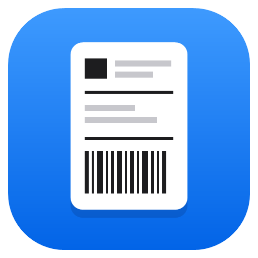
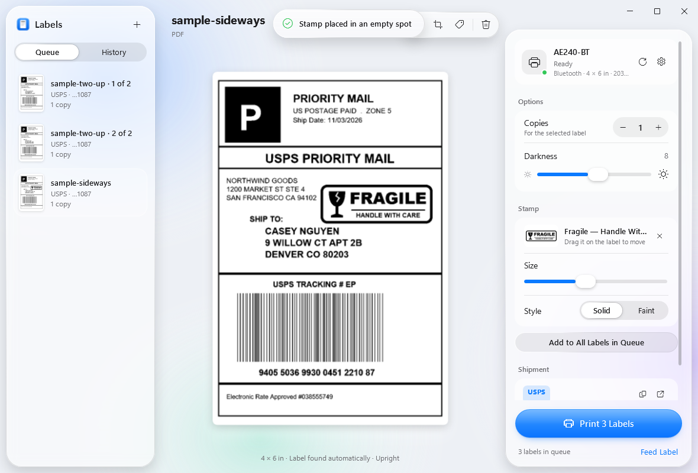
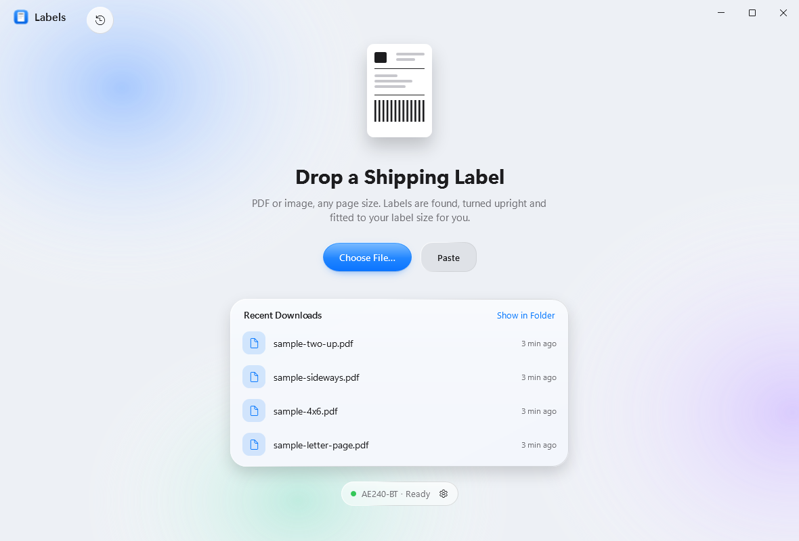
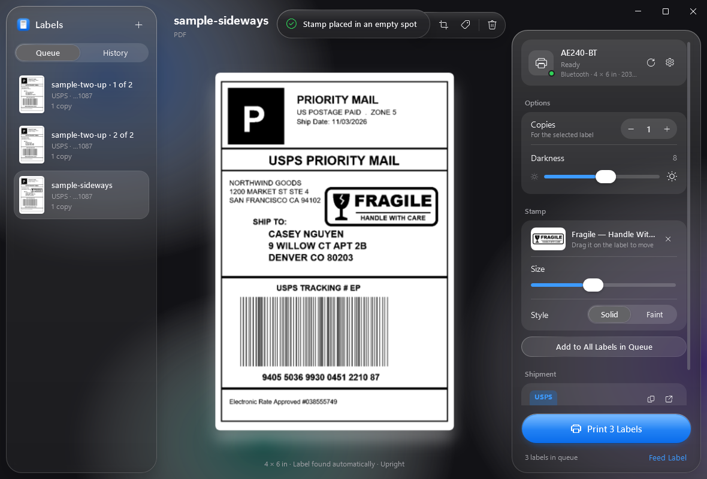
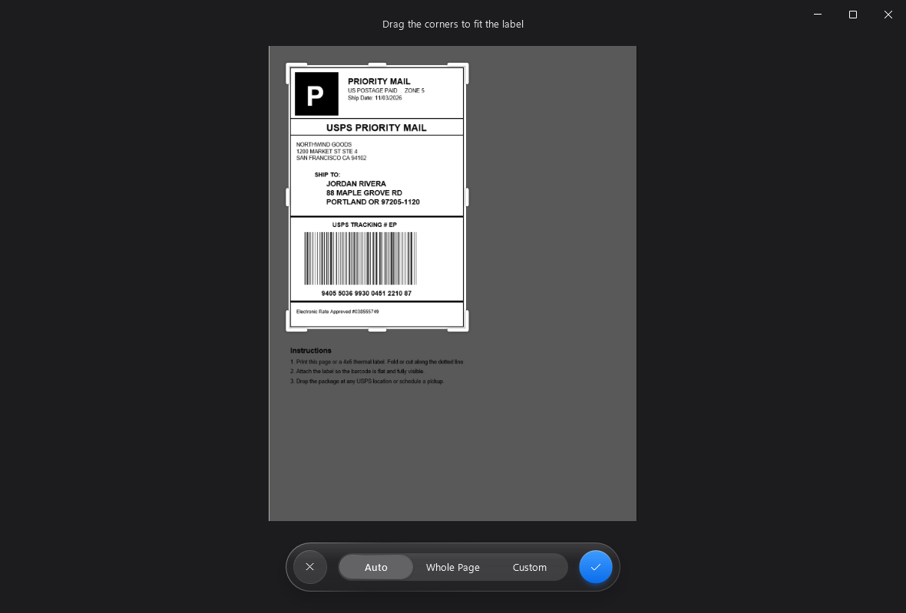
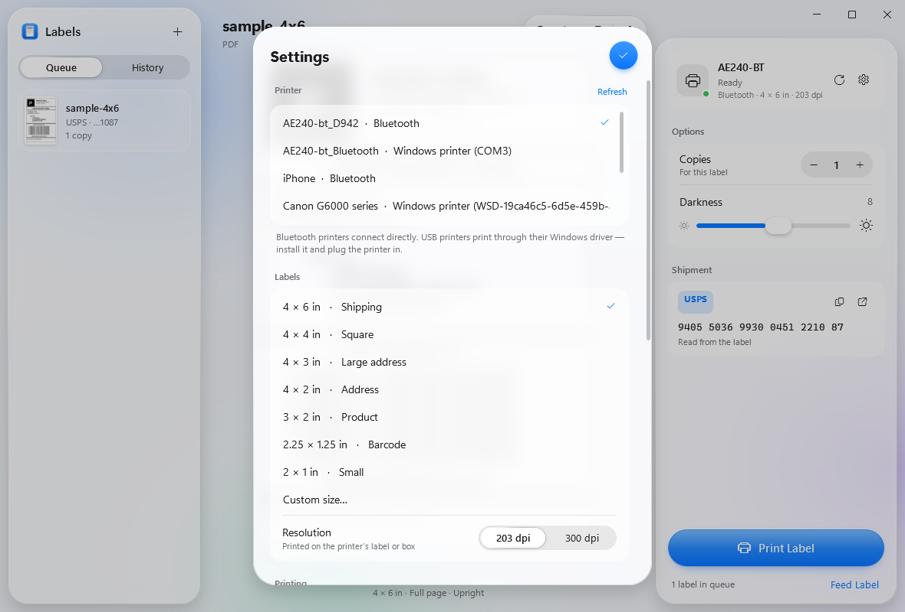
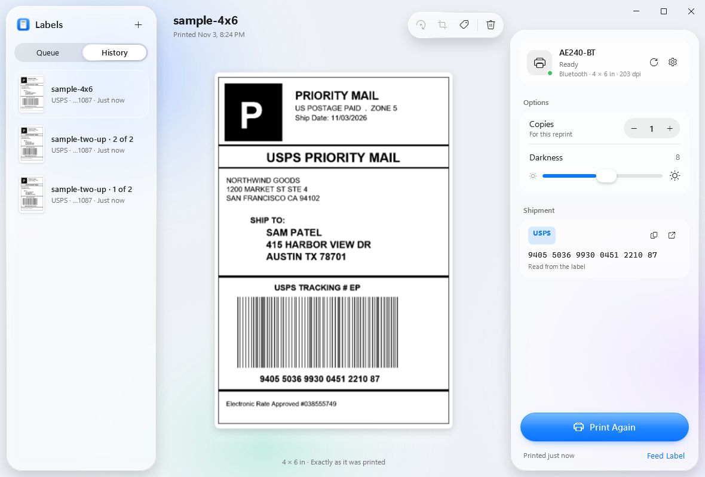
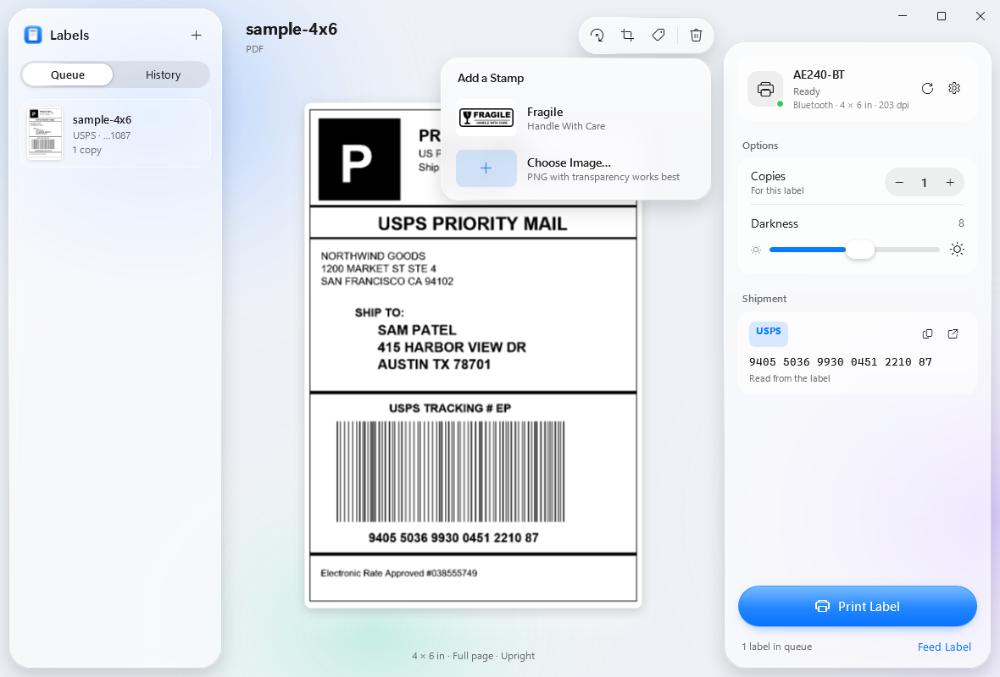

<p align="center">
  
</p>

<h1 align="center">Labels</h1>

<p align="center">
  <b>A beautiful Windows app for thermal label printers.</b><br>
  Drop in a shipping label — it's found, turned upright, fitted and printed. Over Bluetooth or USB.
</p>

<p align="center">
  <a href="https://github.com/AndrewShenouda/Labels/releases/latest"></a>
  
  
  <a href="LICENSE"></a>
</p>

<p align="center">
  
</p>

Cheap 4×6 thermal printers (Helett, iDPRT, Beeprt and friends) are great hardware with frustrating software: phone-only apps, a Windows driver that prints whatever your PDF viewer decides, and labels that come out tiny, cropped or upside down. **Labels** talks to the printer directly and does the fiddly parts for you.

## Features

- **Drop anything** — a PDF or image of any page size. The label is found on the page (even letter-size sheets with instructions and receipts), cropped and fitted to your label stock.
- **Always upright** — the app reads the label's text with Windows' built-in, on-device text recognition to decide which way is up.
- **Two labels on one page?** They're split and printed separately.
- **Tracking at a glance** — the carrier and tracking number are read from the label (UPS, USPS, FedEx, DHL, Amazon, OnTrac) with one-click copy and track.
- **Stamps** — add the built-in *Fragile — Handle With Care* stamp or any image. It's placed in empty space automatically; drag to move, scroll to resize, solid or faint.
- **Print history** — every label you print is kept for one-click reprints.
- **Downloads aware** — new labels saved to Downloads are suggested, or printed automatically if you turn that on.
- **Bluetooth or USB** — Bluetooth printers are driven directly (no COM ports); USB and other printers print through their Windows driver.
- **Any label size** — 4×6, 4×4, 4×3, 4×2, 3×2, 2.25×1.25, 2×1 or custom, at 203 or 300 dpi.
- **Photos-style crop editor**, darkness, speed, calibration, test label, light and dark mode.

<table>
  <tr>
    <td></td>
    <td></td>
  </tr>
  <tr>
    <td align="center"><sub>Drop a label, or pick one from Recent Downloads</sub></td>
    <td align="center"><sub>Dark mode</sub></td>
  </tr>
  <tr>
    <td></td>
    <td></td>
  </tr>
  <tr>
    <td align="center"><sub>Crop editor</sub></td>
    <td align="center"><sub>Printers, label sizes and resolution</sub></td>
  </tr>
  <tr>
    <td></td>
    <td></td>
  </tr>
  <tr>
    <td align="center"><sub>Print history and tracking</sub></td>
    <td align="center"><sub>Stamps</sub></td>
  </tr>
</table>

## Download

1. Grab **`Labels-1.0.0-win-x64.zip`** from the [latest release](https://github.com/AndrewShenouda/Labels/releases/latest).
2. Unzip it anywhere and run **`Labels.exe`**. No installer, no .NET runtime needed.

> Windows SmartScreen may warn about an unrecognised app because the executable isn't code-signed. Choose **More info → Run anyway**, or build it yourself from source (below).

## Printer setup

**Bluetooth**
1. Turn the printer on and pair it in **Windows Settings → Bluetooth & devices**.
2. Open Labels → **Settings** (gear) → choose the printer under **Printer**. Labels connects directly; no COM port or driver is needed.
3. Make sure your phone isn't connected to the printer at the same time — Bluetooth printers accept one connection.

**USB**
1. Install the printer's Windows driver and plug it in, so it appears in **Settings → Printers & scanners**.
2. In Labels → **Settings**, pick it (it's listed as *USB*). Labels sends its commands through that printer queue untouched.

**Then**
- Choose your **label size** and **resolution** (on the printer's sticker or box — most 4×6 printers are 203 dpi).
- After loading a new roll, press **Calibrate** so the printer learns where each label starts. If it feeds a blank label or blinks red, calibrate, or set **Label roll → Continuous** for rolls without gaps.

## Compatible printers

Labels speaks **TSPL**, the command language used by most budget thermal label printers. It's been tested on the **Helett AE240BT**. Printers that share its driver family should work too — for example Helett AD240-BT and A40, Nelko PL70e-BT, Polono PL420, and many iDPRT, Beeprt and Xprinter models.

## Keyboard shortcuts

| Keys | Action |
| --- | --- |
| Ctrl+O | Add labels |
| Ctrl+V | Paste a label (file or image) |
| Ctrl+P | Print |
| R | Rotate |
| C | Crop |
| S | Add a stamp |
| + / − | Copies |
| Delete | Remove from queue / history |
| Esc / Enter | Cancel / confirm crop |

## Build from source

Requires Windows 10 (19041) or later and the [.NET 10 SDK](https://dotnet.microsoft.com/download).

```powershell
git clone https://github.com/AndrewShenouda/Labels.git
cd Labels
dotnet run --project Labels -c Release
```

Make a self-contained build like the release:

```powershell
dotnet publish Labels -c Release -r win-x64 --self-contained -p:PublishSingleFile=true -o publish
```

Sample labels (fictional addresses) for testing can be generated with `tools/make-sample-labels.ps1`.

## How it works

| Piece | File |
| --- | --- |
| TSPL job builder (bitmap bands, only rows with ink) | `Labels/Core/Tspl.cs` |
| Bluetooth RFCOMM transport (Winsock `AF_BTH`) | `Labels/Core/BluetoothPrinter.cs` |
| Windows printer transport (raw spooling via `winspool`) | `Labels/Core/Transport.cs` |
| PDF rendering (`Windows.Data.Pdf`), cropping, 1-bit conversion | `Labels/Core/LabelPage.cs` |
| Finding labels on a page (recursive whitespace cuts) | `Labels/Core/AutoCrop.cs` |
| Orientation, carrier and tracking (`Windows.Media.Ocr`) | `Labels/Core/LabelInsights.cs` |
| Stamps and empty-space placement | `Labels/Core/Stamp.cs` |
| Glass material and spring animations | `Labels/Ui/` |

Settings and print history live in `%AppData%\Labels`.

## Privacy

Everything happens on your PC. Labels has no account, no telemetry and no network access of its own — text recognition is Windows' on-device engine, and the only time a web page opens is when you press **Track Package**.

## License

[MIT](LICENSE). Not affiliated with Helett or any printer manufacturer; product names are used only to describe compatibility.
